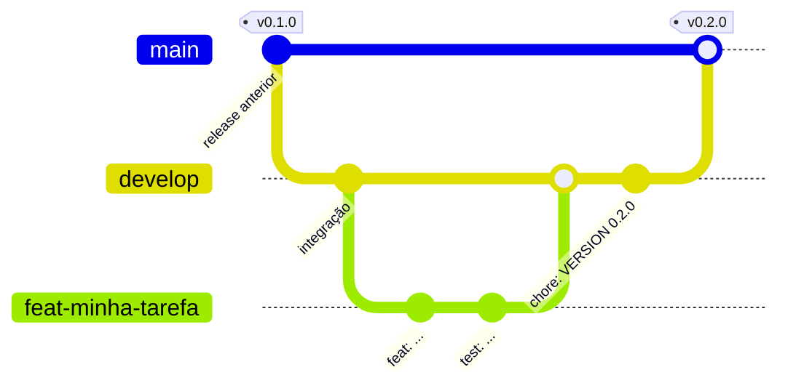

# Guia de Contribuição — delphi-backup-restore

Agradecemos o interesse em contribuir com o **delphi-backup-restore**! Este documento orienta o processo de desenvolvimento, padrões de codificação, regras de compatibilidade técnica e o fluxo de trabalho de integração contínua.

---

## 1. Fluxo de Branches e Worktrees

Adotamos um modelo de ramificação baseado em `develop` e `main`:

- **Branch de Integração (`develop`):** Todas as melhorias, correções e novas funcionalidades devem ser integradas inicialmente na branch `develop`.
- **Branch de Produção e Releases (`main`):** A branch `main` representa o código estável de produção. Ela **nunca** recebe commits diretos, apenas Pull Requests originados de `develop` (ou PRs de correção crítica). Cada merge na branch `main` dispara automaticamente o fluxo de lançamento (`.github/workflows/release.yml`) que cria a tag e publica a nova versão no GitHub Releases.
- **Desenvolvimento Isolado e Agentes de IA:**
  Para manter o repositório limpo e permitir trabalho concorrente seguro, crie sempre branches específicas a partir de `develop` utilizando a pasta reservada `.wc/<tarefa>` (já ignorada pelo `.gitignore`):
  ```cmd
  git worktree add .wc/minha-tarefa -b feat/minha-tarefa develop
  ```
  Ao término da integração, remova a worktree:
  ```cmd
  git worktree remove .wc/minha-tarefa
  ```



Cada tarefa vive numa worktree própria em `.wc/<tarefa>`; o merge na `main` (via PR) dispara o release.

- **Proibições:** Nunca faça push direto na `main` e nunca realize *force-push* (`git push --force`) nas branches `develop` ou `main`.

---

## 2. Padrão de Commits (Conventional Commits)

Todas as mensagens de commit devem seguir a convenção [Conventional Commits](https://www.conventionalcommits.org/):

```text
<tipo>(<escopo opcional>): <descrição sucinta em português ou inglês>
```

### Tipos aceitos:
- `feat:` Uma nova funcionalidade ou comando.
- `fix:` Correção de um bug ou comportamento incorreto.
- `docs:` Alterações em documentação (`README.md`, `ARCHITECTURE.md`, etc.).
- `test:` Adição ou modificação de testes unitários.
- `ci:` Alterações nos arquivos de workflow do GitHub Actions (`pr.yml`, `release.yml`).
- `refactor:` Mudança no código que não altera comportamento nem corrige bug.
- `chore:` Atualizações de build, versão ou tarefas de manutenção rotineira.

> [!WARNING]
> Não inclua trailers como `Co-Authored-By` ou referências a sessões de ferramentas nas mensagens de commit.

---

## 3. Versionamento Semântico (`VERSION`)

O arquivo [VERSION](VERSION) na raiz do repositório define a versão atual do software seguindo a especificação [SemVer](https://semver.org/) (`MAJOR.MINOR.PATCH`).

- **Regra obrigatória:** Ao abrir um Pull Request para a branch `main`, o valor contido no arquivo `VERSION` deve ser estritamente maior que a versão da tag mais recente do repositório (ex.: se a última tag for `v0.1.0`, a versão mínima deverá ser `0.1.1` ou `0.2.0`).
- O pipeline de validação (`.github/workflows/pr.yml`) falhará automaticamente se o número de versão não for incrementado.

---

## 4. Codificação e Formatação de Arquivos

- **Codificação UTF-8 com BOM:** Todos os arquivos de código-fonte Pascal (`.pas` e `.dpr`) nos diretórios `src/` e `tests/` devem ser gravados obrigatoriamente com a marcação de ordem de byte UTF-8 (**UTF-8 with BOM**, bytes iniciais `EF BB BF`). O linter do GitHub Actions reprovará qualquer PR com arquivos sem BOM.
- **Delphi Formatter:** Todo o código submetido deve ser formatado utilizando o formatador padrão de código da IDE Delphi (*Delphi Formatter*), com as opções padrão. Pela linha de comando (sempre com `-silent`; sem ele o `Formatter.exe` abre uma janela modal):
  ```cmd
  "%BDS%\bin\Formatter.exe" -delphi -silent src\MinhaUnit.pas
  ```
  Grave o BOM **antes** de formatar: o formatador preserva a codificação existente.
- **Idioma do Código:**
  - Mensagens de log e textos exibidos na interface (GUI / CLI) devem estar em **Português do Brasil (pt-BR)**.
  - Identificadores de código (nomes de classes, funções, variáveis, constantes, tipos e arquivos) devem estar em **Inglês**.
- **Logging e Tratamento de Exceções:**
  - Todo método público deve registrar sua execução no `ILogger` (nível `Debug` para detalhes operacionais, `Info` para etapas concluídas, `Warn`/`Error` para problemas).
  - Nunca silencie exceções com blocos `except end` vazios sem registrar o erro detalhado no log.

---

## 5. Regras de Compatibilidade Técnica (Delphi XE8+ / CompilerVersion 29)

O código precisa compilar perfeitamente no **Delphi XE8 ou qualquer versão superior**. Recursos introduzidos em versões posteriores ao XE8 (Delphi 10 Seattle, 10.3 Rio, 11 Alexandria, 12 Athens) são **estritamente proibidos**.

### Recursos Proibidos vs. Alternativas Permitidas

| Recurso Proibido | Motivo | Exemplo Errado (Incompatível) | Exemplo Correto (Compatível XE8+) |
|---|---|---|---|
| **Variáveis inline** | Introduzidas no Delphi 10.3 Rio | `begin var I: Integer := 0;` | Declarar explicitamente na seção `var` no início da rotina. |
| **Constantes inline** | Introduzidas no Delphi 10.3 Rio | `begin const C = 10;` | Declarar na seção `const` do escopo ou da rotina. |
| **Inferência de tipos** | Introduzida no Delphi 10.3 Rio | `var S := 'texto';` | Especificar o tipo explicitamente: `var S: string; begin S := 'texto';` |
| **Managed Records** | Introduzidos no Delphi 10.4 Sydney | `record class operator Initialize;` | Utilizar `record` tradicional com inicialização manual ou `class` com construtor/destrutor. |
| **Expressão condicional ternária** | Introduzida no Delphi 12 Athens | `X := if Cond then A else B;` | Utilizar bloco tradicional:<br>`if Cond then X := A else X := B;` |
| **TJSONObject.GetValue\<T>** | Introduzido em versões mais recentes | `Obj.GetValue<string>('chave')` | Utilizar `Obj.Values['chave'].Value` ou `Obj.Get('chave')`. |
| **System.Threading** | Falhas de escalabilidade/suporte no XE8 | `TTask.Run(...)`, `TParallel.For` | Criar subclasses tradicionais de `TThread`. |
| **System.Net.\*** | Biblioteca `System.Net.HttpClient` instável no XE8 | Usar `System.Net.URLClient` | Usar chamadas da WinAPI nativa ou processos externos via `IProcessRunner`. |
| **TArray.Contains / IndexOf** | Métodos genéricos ausentes no XE8 | `TArray.Contains<string>(Arr, 'x')` | Iterar com laço `for .. in` ou criar rotina auxiliar em `Core.Types`. |
| **Strings multilinha (''')** | Introduzidas no Delphi 12 Athens | `S := '''texto longo''';` | Concatenação tradicional de strings com `'linha1' + sLineBreak + 'linha2'`. |
| **Literais binários / separadores** | Introduzidos no Delphi 11/12 | `B := %0101_1010;` | Usar hexadecimal ou decimal: `B := $5A;` |
| **Atributos de memória [Weak]/[Unsafe]** | Incompatíveis com compilação Win32 clássica | `[Weak] FItem: TObject;` | Utilizar referências simples e gerenciamento manual de ponteiros. |
| **Arquivos de formulário .dfm** | Não rastreados no Git | `TForm` associado a arquivo `.dfm` | Formulários criados 100% em código usando `TForm.CreateNew` e instanciando componentes no construtor. |
| **Namespaces incompletos** | Resolução ambígua de units | `uses SysUtils, Classes;` | Utilizar sempre namespaces completos: `uses System.SysUtils, System.Classes, Winapi.Windows;` |
| **Dependências externas** | O projeto deve ser autossuficiente | Bibliotecas de terceiros via Boss/GetIt | Usar apenas RTL/VCL padrão e ferramentas nativas do Windows (`robocopy.exe`, `reg.exe`, `tar.exe`). |

---

## 6. Compilação e Execução de Testes

Antes de submeter qualquer código, valide localmente a compilação e a execução dos testes:

```cmd
:: 1. Compilar os dois binários (bin\DelphiBackupRestore.exe e bin\DelphiBackupRestoreCli.exe)
build.bat

:: 2. Compilar e executar os testes unitários
build.bat --tests
```

O comando deve encerrar com código de saída `0` e sem erros reportados no console.

---

## 7. Checklist do Pull Request

Antes de abrir o seu PR, certifique-se de que todos os itens abaixo foram cumpridos:

- [ ] A branch foi criada a partir de `develop` (e o PR aponta de volta para `develop` ou `main`);
- [ ] O arquivo [VERSION](VERSION) foi incrementado se o PR tiver como destino a branch `main`;
- [ ] Nenhum arquivo `.dfm` ou `.dproj` foi versionado (`git status` limpo desses arquivos);
- [ ] Todos os arquivos `.pas` e `.dpr` novos ou alterados possuem UTF-8 BOM;
- [ ] O código foi formatado através do *Delphi Formatter*;
- [ ] Todas as regras de compatibilidade com Delphi XE8 foram seguidas (sem *inline vars*, sem *ternary if*, sem `System.Threading`);
- [ ] Mensagens de commit seguem a convenção *Conventional Commits* (sem trailers de coautoria);
- [ ] Os testes locais foram executados e passaram com sucesso (`build.bat --tests`);
- [ ] O PR aborda um único assunto ou funcionalidade com descrição clara do que foi implementado.
