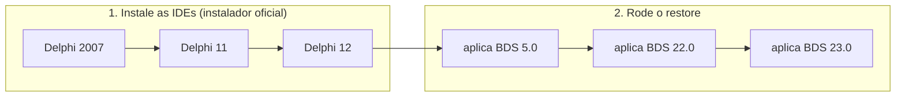
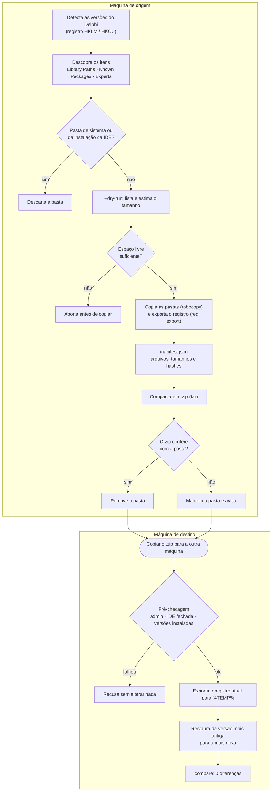
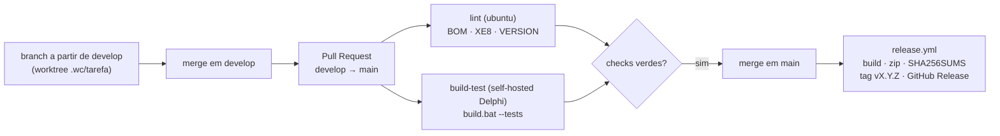

# Delphi Backup & Restore

Ferramenta pública VCL de código aberto para Windows (com interface gráfica e de linha de comando) dedicada ao backup e à restauração completos de ambientes de desenvolvimento Embarcadero Delphi.

---

## Objetivo

Automatizar e garantir a preservação, replicação e restauração exata de ambientes de desenvolvimento Delphi — incluindo componentes de terceiros, pacotes compilados (BPLs/DCPs), caminhos de biblioteca (*Library Paths*), chaves de registro da IDE, *plugins* e *experts* (GExperts, CnWizards, etc.), configurações de ferramentas auxiliares (como Boss) e, opcionalmente, DLLs de terceiros presentes no sistema.

---

## Por que usar?

- **Paridade de Ambientes (Dev, VPS e CI):** Manter a máquina principal de desenvolvimento, máquinas secundárias, ambientes de build em VPS e runners de CI sempre perfeitamente sincronizados e idênticos.
- **Reinstalação Rápida e Confiável:** Após formatar o computador ou migrar para uma nova máquina, evita dias de trabalho manual instalando pacotes, recompilando bibliotecas e reconfigurando propriedades da IDE.
- **Preservação Histórica:** Permite congelar e arquivar o estado completo de versões antigas e projetos legados do Delphi para recuperação imediata quando necessário.

---

## Versão mínima do Delphi para compilar

- **Delphi XE8 (BDS 16.0)** ou superior.
- Os fontes foram projetados para manter total compatibilidade com compiladores a partir do XE8, sem uso de recursos modernos de versões recentes que quebrem a retrocompatibilidade (sem *inline vars*, sem inferência de tipos, sem *ternary if*, sem `System.Threading`/`System.Net` e sem arquivos `.dfm`).

---

## Versões da IDE suportadas no backup

O utilitário detecta automaticamente as instalações presentes nas chaves `HKLM` e `HKCU` e suporta:

- **Delphi 5, 6 e 7:** Identificadores `D5.0`, `D6.0` e `D7.0` (chave `Software\Borland\Delphi`). O prefixo `D` é utilizado para desambiguar com o Delphi 2007 (BDS 5.0).
- **Delphi 2005, 2006 e 2007:** BDS `3.0`, `4.0` e `5.0` (chave `Software\Borland\BDS`).
- **Delphi 2009 e 2010:** BDS `6.0` e `7.0` (chave `Software\CodeGear\BDS`).
- **Delphi XE até XE8:** BDS `8.0` até `16.0` (chave `Software\Embarcadero\BDS`).
- **Delphi 10.x:** 10 Seattle (`17.0`), 10.1 Berlin (`18.0`), 10.2 Tokyo (`19.0`), 10.3 Rio (`20.0`), 10.4 Sydney (`21.0`).
- **Delphi 11 Alexandria:** BDS `22.0`.
- **Delphi 12 Athens:** BDS `23.0`.
- **Delphi 13 Florence:** BDS `37.0`.
- **Versões futuras:** Reconhecidas genericamente com base na árvore de chaves do registro do BDS.

---

## O que é copiado e o que NÃO é

### O que É copiado:
- **Pastas de componentes de terceiros:** Descobertas a partir de *Search Path*, *Browsing Path*, *Debug DCU Path*, *Package DPL Output* e *Package DCP Output* de cada versão e plataforma (Win32/Win64), além dos *Known Packages* instalados.
- **Pacotes compilados:** Arquivos `.bpl` e `.dcp` gerados e referenciados pela IDE.
- **Configurações completas da IDE:** Exportação das chaves de registro por versão (`HKCU\Software\...` e `HKLM\SOFTWARE\...`).
- **Diretórios de trabalho da IDE:** Pastas do usuário e públicas (`$(BDSCOMMONDIR)`, `$(BDSUSERDIR)` e `%APPDATA%\Embarcadero\BDS\<versao>`).
- **Plugins e Experts:** Pastas e arquivos de plugins instalados (GExperts, CnWizards/CnPack, Beyond Compare), além de suas respectivas chaves de registro globais.
- **Gerenciadores de dependências:** Configurações e pacotes do Boss (`%USERPROFILE%\.boss`).
- **Pastas e chaves extras:** Diretórios e chaves de registro definidos no arquivo de configuração `DelphiBackupRestore.json`.
- **DLLs de terceiros (opcional):** Arquivos em `System32` e `SysWOW64` identificados via varredura (`--scan-dlls`).

### O que NÃO é copiado:
- **A instalação da IDE:** Arquivos do diretório base do Delphi (`$(BDS)` / `RootDir`, executáveis `bds.exe`, `dcc32.exe`, ferramentas nativas da Embarcadero).
- **Licenciamento e ativação:** Arquivos de licença (SLIP, `.slip`), ativações e registros proprietários.
- **Updates e patches da IDE:** Devem ser aplicados por meio dos instaladores oficiais da Embarcadero antes de efetuar a restauração.

---

## Ordem de instalação

> [!IMPORTANT]
> **Regra de ouro da comunidade Delphi:** Instale sempre as IDEs da **mais antiga para a mais nova** antes de executar a restauração do backup. O processo de restauração aplica os dados rigorosamente da **mais antiga para a mais nova**.

Essa ordem garante que variáveis de ambiente, BPLs compartilhadas no `PATH` do sistema e chaves de registro de subsistemas comuns sejam resolvidas com as versões mais recentes das bibliotecas, evitando conflitos de sobreposição.
Para detalhes sobre essa necessidade técnica, consulte os consensos da comunidade:
- [Can Rio and Sydney co-exist? (Delphi-Praxis)](https://en.delphipraxis.net/topic/2900-can-rio-and-sydney-co-exist)
- [Delphi 10 and up install notes (Jeroen Pluimers / wiert.me)](https://wiert.me/2025/06/18/delphi-10-and-up-install-notes/)




A restauração opera no modo **sobrescrever por padrão** (*overwrite by default*). Para analisar divergências antes de aplicar alterações, execute o comando de comparação (`compare`).

> [!WARNING]
> **O restore espelha as pastas** (`robocopy /MIR`): cada pasta restaurada fica **idêntica** à do backup. Arquivos que existem **apenas** na máquina de destino, dentro dessas pastas, **são apagados**. Antes do restore o registro atual das versões escolhidas é exportado para `%TEMP%\DelphiBackupRestore_pre_<data>`, mas arquivos apagados pelo espelhamento não têm cópia automática. Teste primeiro em uma VM e rode `compare` antes.

---

## Como funciona

### Fluxo completo



### Layout do backup gerado

```text
DelphiEnv_<NOME_MAQUINA>_<yyyyMMdd_HHnn>\
  ├── manifest.json            # Metadados, versões, itens e hashes SHA-256
  ├── backup.log               # Log completo detalhado da execução
  ├── files\                   # Conteúdo de diretórios e arquivos individuais
  │   └── <ItemId>\...
  ├── registry\                # Exportações de registro (UTF-16 LE com BOM)
  │   └── <ItemId>.reg
  └── dlls\                    # DLLs opcionais de terceiros (quando scan ativo)
      └── <ItemId>\<arquivo>
```

Se a opção de compactação estiver habilitada (padrão), o arquivo `DelphiEnv_<NOME_MAQUINA>_<yyyyMMdd_HHnn>.zip` será gerado no mesmo diretório de destino. Depois de gerar o zip, a ferramenta **confere** a quantidade de arquivos do zip (`tar -t`) contra a da pasta e, **somente se conferir**, remove a pasta — o backup fica só no `.zip`. Se não conferir, a pasta é mantida e um aviso é registrado. Use `--keep-folder` (ou a opção na tela) para manter também a pasta.

### Manifesto e privilégios (`asInvoker`)

O executável possui manifesto com nível de execução `asInvoker`. Isso significa que:
- **Visualizar, listar, comparar e fazer backup** não requer privilégios de administrador.
- **Restauração** exige elevação de privilégios (para gravar chaves `HKLM`, criar diretórios em áreas protegidas e atualizar variáveis de ambiente do sistema).
- Na interface gráfica (GUI), se o programa for iniciado sem privilégios elevados e o usuário selecionar o modo **Restaurar**, é exibido o botão **"Reiniciar como administrador"**.

---

## Segurança

- **Proteção de pastas do sistema:** Raízes de pastas de sistema (`C:\Windows`, `C:\Program Files`, `C:\Program Files (x86)`, `C:\Users`, raiz de discos `C:\`, etc.) e pastas pertencentes à instalação oficial da IDE (`RootDir`) são bloqueadas e **nunca** são copiadas integralmente.
- **Prevenção de loops e recursão:** O backup aborta imediatamente se o diretório de destino escolhido estiver localizado dentro de uma das pastas a serem copiadas.
- **Checagem prévia de espaço em disco:** O mecanismo calcula o tamanho total estimado de todos os itens antes de copiar qualquer arquivo, exigindo espaço livre para os arquivos descompactados + margem de 5% + espaço para o `.zip`.
- **Deduplicação de itens compartilhados:** Diretórios e bibliotecas compartilhados por múltiplas versões do Delphi instaladas na mesma máquina são copiados uma única vez.
- **Raiz de componente segura:** a pasta raiz de um componente sobe a partir do caminho da biblioteca, mas para antes de qualquer pasta de sistema, antes de qualquer pasta que contenha a instalação/configuração de **qualquer** Delphi instalado e na raiz de um repositório (`.git`, `.svn`, `.hg`). O `PATH` salvo na IDE **não** é usado para descobrir pastas (ele contém o PATH inteiro do sistema).
- **Dupla checagem:** as mesmas regras são verificadas de novo imediatamente antes da cópia; qualquer pasta insegura **aborta** o backup antes de copiar o primeiro arquivo.
- **Simulação:** `backup --dry-run` lista cada item com o tamanho estimado sem copiar nada — use antes do primeiro backup.

---

## Como usar — Interface Gráfica (GUI)

Execute `DelphiBackupRestore.exe` sem parâmetros:

1. **Escolha o modo de operação:**
   - **Backup:** Cria uma cópia das configurações e componentes.
   - **Restaurar:** Restaura um backup existente (exige elevação de administrador; utilize o botão **Reiniciar como administrador** se necessário).
   - **Comparar:** Compara um backup com o ambiente atual e aponta diferenças.
2. **Selecione as versões do Delphi:** Marque as versões da IDE que deseja incluir.
3. **Selecione os itens:** Escolha os componentes, configurações e plugins. Se desejar, marque a opção **Procurar DLLs de terceiros**.
4. **Defina os caminhos:** Aponte o diretório de destino (para backup) ou o arquivo `.zip` / pasta de origem (para restore/compare).
5. **Acompanhe a execução:** O progresso e as mensagens detalhadas de log são exibidos em tempo real na tela.

---

## Como usar — Linha de Comando (CLI)

Para execução via terminal, scripts batch/PowerShell, rotinas automatizadas e pipelines de CI, utilize o executável console:

```cmd
bin\DelphiBackupRestoreCli.exe <comando> [opções]
```

> [!TIP]
> `DelphiBackupRestoreCli.exe` foi compilado como aplicação de console nativa, com saída imediata de texto e códigos de saída confiáveis.
> **Recomendação:** Antes de efetuar o seu primeiro backup, execute o comando com a opção `--dry-run` para inspecionar os itens descobertos e o tamanho estimado sem gravar nada no disco.

### Comandos disponíveis

| Comando | Descrição |
|---|---|
| `list` | Lista as versões instaladas da IDE e seus respectivos identificadores. |
| `backup` | Cria o backup do ambiente (requer `--dest`). |
| `restore` | Restaura um backup no ambiente (requer `--source` e privilégios de Administrador). |
| `compare` | Compara um backup com o ambiente atual (requer `--source`). |
| `--version` | Exibe a versão da ferramenta. |
| `--help` | Exibe a ajuda detalhada. |

### Opções

| Opção | Descrição |
|---|---|
| `--versions <lista>` | Versões a processar, separadas por vírgula (ex.: `--versions 22.0,D7.0`). Padrão: todas instaladas. |
| `--dest <pasta>` | Diretório onde a pasta e o `.zip` do backup serão criados (requerido em `backup`). |
| `--source <pasta\|zip>` | Caminho da pasta ou do arquivo `.zip` do backup (requerido em `restore` e `compare`). |
| `--dry-run` | Executa a descoberta e lista itens e tamanhos estimados **sem copiar arquivos** (válido para `backup`). |
| `--no-zip` | Não gera o arquivo `.zip` compactado (mantém apenas a pasta descompactada). |
| `--keep-folder` | Com zip: mantém também a pasta do backup (padrão: a pasta é removida depois de conferir o zip). |
| `--scan-dlls` | Executa varredura de DLLs de terceiros em `System32` e `SysWOW64`. |
| `--categories <lista>` | Categorias a incluir: `components`, `ide-config`, `experts`, `boss`, `extra`, `system-dll`. |
| `--config <arquivo>` | Caminho para arquivo de configuração JSON customizado (padrão: `DelphiBackupRestore.json` ao lado do executável). |

### Códigos de saída (Exit Codes)

| Código | Constante | Significado |
|---|---|---|
| `0` | `EXIT_OK` | Operação concluída com sucesso. |
| `1` | `EXIT_DIFFERENCES` | O comando `compare` encontrou diferenças entre o backup e a máquina atual. |
| `2` | `EXIT_ERROR` | Erro geral durante o processamento. |
| `3` | `EXIT_PRECHECK` | Falha em pré-requisito (IDE aberta, versão necessária não instalada, falta de privilégios de admin no restore). |
| `4` | `EXIT_USAGE` | Parâmetros ou sintaxe de linha de comando inválidos. |

### Exemplos práticos

```cmd
:: 1. Listar versões instaladas
DelphiBackupRestoreCli.exe list

:: 2. Simular backup antes da primeira execução (Dry Run)
DelphiBackupRestoreCli.exe backup --dest "D:\Backups" --dry-run

:: 3. Fazer backup completo de todas as versões
DelphiBackupRestoreCli.exe backup --dest "D:\Backups"

:: 4. Fazer backup apenas do Delphi 11 e Delphi 7 incluindo varredura de DLLs
DelphiBackupRestoreCli.exe backup --versions 22.0,D7.0 --dest "D:\Backups" --scan-dlls

:: 5. Comparar o ambiente com um backup existente
DelphiBackupRestoreCli.exe compare --source "D:\Backups\DelphiEnv_DEV_20261119_1200.zip"

:: 6. Restaurar backup (executado em prompt de comando elevado como Administrador)
DelphiBackupRestoreCli.exe restore --source "D:\Backups\DelphiEnv_DEV_20261119_1200.zip"
```

---

## DLLs de terceiros (`--scan-dlls`)

Ao habilitar a opção `--scan-dlls`:
- A ferramenta analisa os cabeçalhos PE (PE32 e PE32+) de executáveis e pacotes compilados para identificar tabelas de importação (*Import Table* e *Delay-Load*).
- Realiza uma varredura em `C:\Windows\System32` e `C:\Windows\SysWOW64` por DLLs e BPLs cuja empresa desenvolvedora (*CompanyName*) não seja Microsoft nem faça parte da instalação base do Delphi.
- **Regra de integridade no restore:** **Nunca rebaixa versão** (*never downgrade*). Uma DLL de terceiros só é copiada para o destino caso ela ainda não exista no sistema ou caso a versão do arquivo no backup seja comprovadamente mais recente do que a instalada.

---

## Arquivo de configuração `DelphiBackupRestore.json`

O comportamento de cópia e exclusão pode ser estendido criando o arquivo `DelphiBackupRestore.json` no mesmo diretório dos executáveis:

```json
{
  "extraFolders": [
    "C:\\Componentes\\BibliotecasProprias",
    "%USERPROFILE%\\Documents\\MeusComponentes"
  ],
  "extraRegistryKeys": [
    "HKCU\\Software\\MinhaEmpresa\\FerramentasDelphi"
  ],
  "excludeDirs": [
    "__history",
    "__recovery",
    "node_modules",
    "Debug"
  ],
  "excludeFiles": [
    "*.identcache",
    "*.dcu",
    "*.stat",
    "*.local",
    "*.tmp",
    "*.~*"
  ]
}
```

- `excludeDirs` e `excludeFiles` comparam o **nome** da pasta/arquivo (mesma semântica de `robocopy /XD /XF`), aceitando `*` e `?`; caminhos como `Win32\Debug` não funcionam — use `Debug`.
- As exclusões padrão já incluem `__history`, `__recovery`, `Samples`, `*.~*` e os SDKs de plataforma baixados pelo instalador (`AndroidNDK-*`, `AndroidSDK-*`, `OpenJDK-*`, `AdoptOpenJDK-*`).
- Excluir `.svn`/`.git` reduz bastante o tamanho, mas a cópia restaurada **deixa de ser uma working copy** (não dá mais para `svn update`/`git pull` nela).

---

## Requisitos do Sistema

- **Sistema Operacional:** Windows 10 (versão 1803 ou superior), Windows 11, Windows Server 2019 ou Windows Server 2022 (o utilitário utiliza nativamente o comando `tar.exe` do Windows para manipulação de arquivos `.zip`).
- **Privilégios:**
  - Usuário comum (*asInvoker*) para `backup`, `compare` e `list`.
  - **Administrador** (*Elevated Privileges*) obrigatório para `restore`.
- **Estado da IDE:** no **restore** todas as instâncias do Delphi (`bds.exe` e `delphi32.exe`) **precisam** estar encerradas (a pré-checagem recusa). No **backup** é recomendado fechar a IDE para capturar configurações consistentes.

---

## Como compilar

O projeto utiliza scripts baseados no compilador de linha de comando oficial da Embarcadero (`dcc32`):

```cmd
:: Compila ambos os executáveis (bin\DelphiBackupRestore.exe e bin\DelphiBackupRestoreCli.exe)
build.bat

:: Compilar com uma versão específica do BDS instalada
build.bat --bds 22.0

:: Compilar e executar a suíte completa de testes unitários
build.bat --tests
```

O script `build.bat`:
1. Localiza o ambiente de compilação da IDE via `rsvars.bat`.
2. Extrai a versão a partir do arquivo `VERSION` e gera o recurso `src\VersionInfo.rc`.
3. Compila os recursos com `cgrc` (ou `brcc32` quando `cgrc` não existir), incorporando o manifesto `DelphiBackupRestore.manifest`, e **falha** se o `.res` gerado sair vazio.
4. Compila a aplicação gráfica: `bin\DelphiBackupRestore.exe`.
5. Compila a aplicação console: `bin\DelphiBackupRestoreCli.exe`.
6. Se `--tests` for informado, compila e executa `tests\DelphiBackupRestoreTests.dpr`.

---

## CI/CD e Automação

O repositório possui fluxos de trabalho configurados no GitHub Actions:




- **PR Validation (`.github/workflows/pr.yml`):**
  - Executado em pull requests para a branch `main`.
  - **Job `lint` (ubuntu-latest):** Valida a ausência de arquivos `.dfm`/`.dproj`, verifica se todos os fontes possuem UTF-8 BOM, valida regras de sintaxe compatíveis com Delphi XE8+ e exige que `VERSION` seja estritamente superior à última tag `v*`.
  - **Job `build-test`:** Executa em runner com labels `[self-hosted, windows, delphi]`, roda `build.bat --tests` e publica os artefatos compilados.
- **Release Automatizado (`.github/workflows/release.yml`):**
  - Disparado em merges na branch `main`.
  - Compila e testa os dois executáveis, gera pacote `.zip`, calcula `SHA256SUMS`, extrai notas de versão a partir dos commits (`notes.md`), cria a tag `v<VERSION>` e publica o GitHub Release automaticamente via GitHub CLI (`gh`).

### Configurando o Runner Self-Hosted
Para configurar uma máquina Windows com Delphi como runner de CI:
1. No repositório GitHub, acesse **Settings > Actions > Runners > New self-hosted runner**.
2. Baixe e configure o runner no Windows conforme as instruções do GitHub.
3. Adicione as seguintes tags/labels personalizadas ao runner:
   `self-hosted`, `windows`, `delphi`
4. Certifique-se de que o Delphi XE8+ esteja instalado e com `rsvars.bat` funcional no registro.

> [!CAUTION]
> Num repositório público, um runner self-hosted executa o código do Pull Request **na sua máquina**. Por isso o job `build-test` só roda para PRs abertos a partir de branches **do próprio repositório**; PRs vindos de forks passam apenas pelo `lint` (em runner do GitHub). Mantenha também em **Settings > Actions > General** a opção **Require approval for all outside collaborators** e use um usuário do Windows sem privilégios de administrador para o serviço do runner.

### Proteção de Branch
Recomenda-se configurar a proteção da branch `main` no GitHub (**Settings > Branches > Add branch protection rule**):
- Marcar **Require status checks to pass before merging**.
- Exigir os checks: `lint` e `build-test`.
- Exigir **Require branches to be up to date before merging**.

---

## Contribuindo

Para manter a estabilidade e a retrocompatibilidade do projeto, siga as diretrizes essenciais:

1. **Fork e Branches:** Crie sua branch a partir de `develop` (ou utilize worktrees isoladas em `.wc/<tarefa>`); a branch `main` só recebe PRs.
2. **Conventional Commits:** Escreva mensagens no padrão `feat:`, `fix:`, `docs:`, `test:`, `ci:`, `refactor:` ou `chore:` (sem trailers).
3. **Subir VERSION:** Ao submeter um PR para `main`, incremente o arquivo `VERSION` (SemVer).
4. **Compatibilidade XE8+:** Respeite rigorosamente a sintaxe suportada pelo Delphi XE8 (sem *inline vars*, sem *ternary*, sem `.dfm`).
5. **Padrão de Arquivos:** Todo arquivo `.pas` e `.dpr` deve ser salvo em **UTF-8 com BOM** e formatado com o **Delphi Formatter**.
6. **Testes Obrigatórios:** Todos os testes unitários devem passar (`build.bat --tests`).
7. **Escopo Único:** Mantenha um único objetivo ou correção por Pull Request.
8. **Sem dependências externas:** O projeto depende exclusivamente da VCL e das ferramentas nativas do Windows (`robocopy`, `reg`, `tar`).

Consulte o guia detalhado em [CONTRIBUTING.md](CONTRIBUTING.md).

---

## Limitações conhecidas

- **Teste inicial em VM recomendado:** Como a restauração escreve no registro do Windows (`HKLM`/`HKCU`) e recria caminhos de biblioteca no sistema, recomenda-se validar o procedimento pela primeira vez em uma Máquina Virtual antes de aplicar no ambiente definitivo.
- **Remapeamento de perfis de usuário:** Se a máquina de destino possuir um nome de usuário diferente da máquina de origem, os caminhos baseados em `%USERPROFILE%` (ex.: `C:\Users\Antigo` -> `C:\Users\Novo`) são automaticamente remapeados, mas caminhos absolutos arbitrários fora da pasta de usuário devem ser verificados manualmente.
- **DLLs de terceiros:** A varredura de DLLs é um recurso complementar e opcional. Softwares que dependem de drivers proprietários ou serviços de sistema adicionais ainda devem ser instalados via seus respectivos instaladores.
- **Indexadores (TortoiseSVN/TortoiseGit, antivírus, Windows Search):** ao gravar cópias de working copies (`.svn`/`.git`), esses programas podem segurar arquivos por alguns segundos. A remoção da pasta após o zip tenta novamente por ~10 s; se ainda assim falhar, a pasta é mantida e o log avisa. Fechar o cache do Tortoise (ícone na bandeja) libera os arquivos.
- **Tamanho:** componentes com histórico de versão (working copies SVN/Git) e libs pré-compiladas para várias versões do Delphi podem ocupar vários GB. Rode `--dry-run` para ver o tamanho antes.

---

## Licença

Distribuído sob os termos da licença MIT. Consulte o arquivo [LICENSE](LICENSE) para mais detalhes.

Copyright (c) 2026 Evaldo Avelar Marques.
