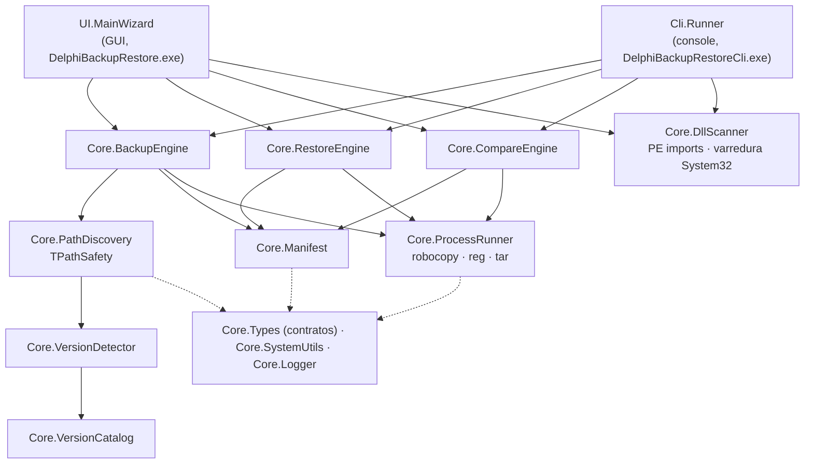
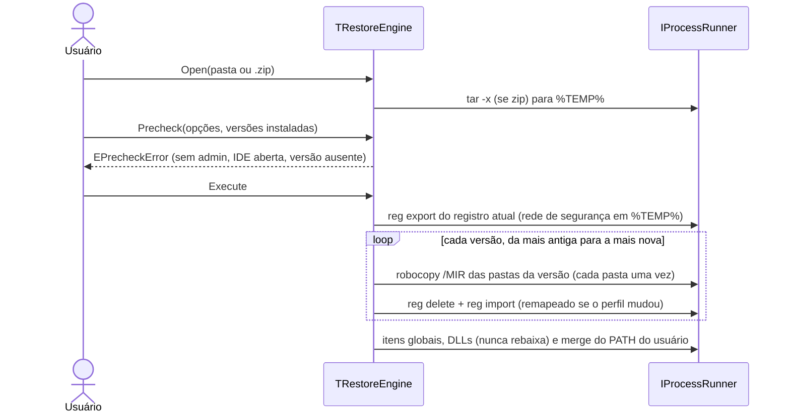
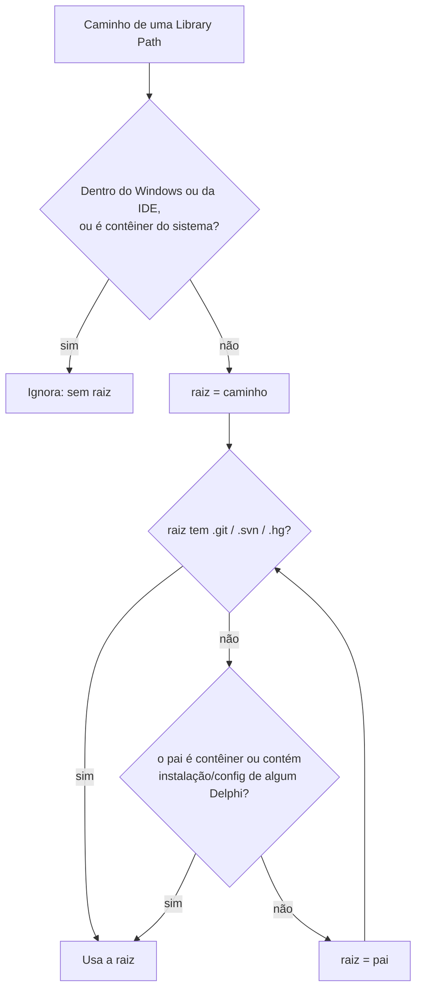

# Arquitetura — delphi-backup-restore

Contrato de implementação. Tipos compartilhados vivem em `src/Core.Types.pas` (**não alterar sem
combinar** — todas as units dependem dele). Cada unit abaixo tem um dono; não edite unit de outro dono.

## Visão geral dos módulos



## Sequência do restore



## Regras de segurança da descoberta

Uma pasta raiz de backup **nunca** pode ser um contêiner do sistema (raiz de drive, `Windows`,
`Program Files` — os três: `ProgramW6432`, `ProgramFiles`, `ProgramFiles(x86)` —, `ProgramData`, `Users`,
perfil, Documents, AppData Roaming/Local, Public, Public Documents), nem conter a instalação ou as pastas de
configuração (`RootDir`, `BDSCOMMONDIR`, `BDSUSERDIR`, AppData) de **qualquer** Delphi instalado, e nada dentro
do Windows é copiado. O `Environment Variables\PATH` do BDS **não** é fonte de pastas (contém o PATH inteiro do
sistema). As regras vivem em `TPathSafety` (`Core.PathDiscovery`), valem na descoberta (filtro final) e são
verificadas de novo pelo `TBackupEngine` antes de copiar (aborta). Cobertas por `tests/Tests.Core.Safety.pas`.



## Regras de compatibilidade (Delphi XE8 = CompilerVersion 29 até a mais nova)
- Proibido: inline `var`/`const` dentro de blocos, inferência de tipo, managed records (`class operator
  Initialize`), expressão ternária `if ... then ... else` como valor, `TJSONObject.GetValue<T>(path)`,
  `System.Net.*`, `System.Threading` (TTask/TParallel), `TArray.Contains`/`IndexOf`, strings multilinha `'''`,
  literais binários `%0101`, separador `_` em números, atributos `[Weak]`/`[Unsafe]`.
- Permitido: generics (`TList<T>`, `TObjectList<T>`, `TDictionary<K,V>`), anonymous methods, `System.JSON`
  (TJSONObject/TJSONArray/TJSONString/TJSONNumber/TJSONTrue/TJSONFalse, `Get`, `Values[]`, `ToString`,
  `TJSONObject.ParseJSONValue`), `System.Hash.THashSHA2`, `System.IOUtils`, `System.Win.Registry`,
  `Winapi.Windows`, `Winapi.ShellAPI`, `Vcl.*`.
- Sem `.dfm`: forms criados em código (`TForm.CreateNew`).
- Units com namespace completo (`System.SysUtils`, não `SysUtils`).
- Sem dependências externas. Ferramentas do Windows: `robocopy.exe`, `reg.exe`, `tar.exe` via `IProcessRunner`.
- Mensagens de log/GUI em português do Brasil; identificadores em inglês.
- Todo método público loga entrada e resultado relevante via `ILogger` (Debug para detalhe, Info para passos,
  Warn/Error para problemas). Nunca engolir exceção sem logar.

## Layout do backup
```
DelphiEnv_<MAQUINA>_<yyyyMMdd_HHnn>\
  manifest.json            (Core.Manifest)
  backup.log
  files\<ItemId>\...       ikFolder: conteúdo da pasta; ikFile: o arquivo
  registry\<ItemId>.reg    ikRegistry (reg export, UTF-16 LE com BOM, como o reg.exe gera)
  dlls\<ItemId>\<arquivo>  ikDll
```
Zip opcional: `DelphiEnv_<MAQUINA>_<stamp>.zip` ao lado da pasta (tar -a -c -f), contendo a pasta.

## Units e assinaturas públicas

### Core.Logger
```pascal
function CreateLogger: ILogger;   // thread-safe (TCriticalSection); arquivo UTF-8; linha:
                                  // 'yyyy-mm-dd hh:nn:ss.zzz [LEVEL] mensagem'
```

### Core.ProcessRunner
```pascal
function CreateProcessRunner(const ALogger: ILogger): IProcessRunner;
```
`CreateProcess` com `CREATE_NO_WINDOW`, pipes para stdout/stderr, leitura contínua (evita deadlock).
Saída de robocopy/reg decodificada com a code page OEM (`GetOEMCP`). `CopyTree`: `robocopy src dst /E|/MIR
/COPY:DAT /DCOPY:T /R:1 /W:1 /MT:16 /NP /NFL /NDL /XJ /XD ... /XF ...`; sucesso quando exit code < 8.
`CopyFile`: `robocopy dir dst arquivo /COPY:DAT /R:1 /W:1`. `RegExport`: `reg export <key> <file> /y`
(+ `/reg:32` se HKLM). `RegImport`: `reg import <file>` (+ `/reg:32` se AHklm32). `RegDelete`:
`reg delete <key> /f` (sucesso também se a chave não existir). `ZipFolder`: `tar -a -c -f <zip> -C <pai>
<nomePasta>`. `UnzipTo`: `tar -x -f <zip> -C <dest>`.

### Core.SystemUtils
```pascal
function IsRunningAsAdmin: Boolean;
function IsDelphiIdeRunning(out AProcessNames: string): Boolean;  // bds.exe, delphi32.exe (Toolhelp32)
function ExpandEnvVars(const AText: string): string;              // %VAR%
function GetUserProfileDir: string;      // sem barra final
function GetPublicDir: string;           // %PUBLIC%
function GetAppDataDir: string;          // %APPDATA%
function GetDocumentsDir: string;        // SHGetFolderPath(CSIDL_PERSONAL)
function GetSystem32Dir: string;
function GetSysWow64Dir: string;         // '' em Windows 32-bit
function GetFileVersionText(const AFileName: string): string;   // 'a.b.c.d' ou ''
function GetFileCompany(const AFileName: string): string;       // VersionInfo CompanyName ou ''
function CompareVersionText(const A, B: string): Integer;        // -1/0/1, numérico por parte
function NormalizePath(const APath: string): string;             // ExpandFileName, sem barra final, '' se inválido
function IsPathInside(const APath, AParent: string): Boolean;    // case-insensitive
function GetUserPathEnv: string;                                 // HKCU\Environment\Path
procedure SetUserPathEnv(const AValue: string);                  // grava + WM_SETTINGCHANGE
function ToolVersion: string;                                    // lido do recurso VERSIONINFO ou '0.0.0'
function MachineName: string;
```

### Core.VersionCatalog
```pascal
function ProductNameForVersion(AEra: TDelphiEra; const ABdsVersion: string): string;
// D5..D7 (Borland\Delphi 5.0/6.0/7.0), BDS 3.0=Delphi 2005, 4.0=2006, 5.0=2007, 6.0=2009, 7.0=2010,
// 8.0=XE, 9.0=XE2, 10.0=XE3, 11.0=XE4, 12.0=XE5, 14.0=XE6, 15.0=XE7, 16.0=XE8, 17.0=10 Seattle,
// 18.0=10.1 Berlin, 19.0=10.2 Tokyo, 20.0=10.3 Rio, 21.0=10.4 Sydney, 22.0=11 Alexandria,
// 23.0=12 Athens, 37.0=13 Florence. Desconhecida -> 'Delphi (BDS x.y)'.
function RegistryRootForEra(AEra: TDelphiEra): string;  // 'Software\Embarcadero\BDS' etc.
function StudioFolderName(AEra: TDelphiEra): string;    // pasta em Documents/Public: 'Embarcadero\Studio',
                                                        // 'RAD Studio' (CodeGear/BDS5), 'Borland Studio Projects'
```

### Identificador de versão
`TDelphiVersion.BdsVersion` é o **identificador** da versão na máquina e no manifest. É o nome da chave
de registro (`'22.0'`, `'5.0'`), exceto na era `Borland\Delphi` (Delphi 5..7), que recebe o prefixo `D`
(`'D7.0'`): Delphi 5 e Delphi 2007 (BDS 5.0) usam ambos a chave `5.0`. Helpers em `Core.Types`:
`LegacyDelphiId`, `IsLegacyDelphiId`, `VersionIdNumber`. A CLI aceita o identificador (`--versions D7.0,22.0`).

### Core.VersionDetector
```pascal
function CreateVersionDetector(const ALogger: ILogger): IVersionDetector;
```
Varre `HKLM\SOFTWARE\WOW6432Node\<root>\*` e `HKLM\SOFTWARE\<root>\*` (32-bit OS) + `HKCU\Software\<root>\*`
para as 4 eras. Instalada = `RootDir` existe e `bin\bds.exe` ou `bin\delphi32.exe` existe. Preenche
todos os campos de `TDelphiVersion` (CommonDir/UserDir/AppDataDir: ler `Environment Variables` do HKCU
(`BDSCOMMONDIR`) se existir; senão derivar por era). Lista ordenada com `SortOldestFirst`.

### Core.PathDiscovery
```pascal
function CreatePathDiscovery(const ALogger: ILogger): IPathDiscovery;
function ResolveBdsMacros(const AText: string; AVersion: TDelphiVersion; const APlatform: string): string;
procedure ReduceToRootFolders(APaths: TStrings);   // remove caminhos contidos em outros
function LoadToolConfig(const AFileName: string; AConfig: TToolConfig; const ALogger: ILogger): Boolean;
```
Regras no README/plano: Library\<plataforma> (Search Path, Browsing Path, Package DPL Output, Package DCP
Output, Debug DCU Path), Known Packages, Known IDE Packages, Disabled Packages, Experts,
Environment Variables\PATH. Macros: `$(BDS)`, `$(BDSCOMMONDIR)`, `$(BDSUSERDIR)`, `$(BDSLIB)`,
`$(BDSINCLUDE)`, `$(BDSBIN)`, `$(Platform)`, `$(Config)`→`Release`, `%VAR%`; macros não resolvidas →
descartar. Descartar caminhos inválidos (`..\C:\...`), inexistentes e os dentro de `RootDir` (exceto arquivos
de Experts/Known IDE Packages fora dos que vêm no instalador → ikFile, categoria icExperts). Raiz de
componente = pasta mais alta que ainda não seja de sistema: subir de cada caminho até achar o diretório cujo
pai seja `Program Files`, `Program Files (x86)`, raiz do drive, `Documents`, perfil do usuário etc. (usar o
**primeiro nível abaixo** desses), e depois `ReduceToRootFolders`. Itens fixos por versão: CommonDir,
UserDir, AppDataDir (icIdeConfig), `HKCU\<RegistryKey>` e `HKLM\SOFTWARE\<RegistryKey sem 'Software\'>`
(icIdeConfig). Experts: pasta da DLL fora do RootDir (icExperts) + chaves globais conhecidas que existirem:
`HKCU\Software\GExperts`, `HKCU\Software\CnPack`, `HKCU\Software\Scooter Software` (Versions vazio = global).
`%USERPROFILE%\.boss` (icBoss, global) se existir. ExtraFolders/ExtraRegistryKeys do config (icExtra).
Mesma pasta usada por várias versões → um item só, com todas as versões em `Versions`.

### Core.Manifest
```pascal
procedure SaveManifest(AManifest: TManifest; const AFileName: string);   // JSON UTF-8 indentado
function LoadManifest(const AFileName: string): TManifest;              // raise EDelphiBackupError se inválido
procedure ScanItemFiles(const ARoot: string; AItem: TManifestItem; AExcludeDirs, AExcludeFiles: TStrings);
  // lista arquivos recursivamente (RelPath, Size, ModifiedUtc) ordenados por RelPath; ikFile = só o arquivo
function ComputeListingHash(AItem: TManifestItem): string;  // SHA256 de 'RelPath|Size|ModifiedUtc'#10 por linha
function NormalizeRegFile(const AFileName: string): string; // texto do .reg sem cabeçalho, sem linhas vazias,
  // ignorando valores voláteis (Closed Files, Closed Projects, History Lists, Session, Desktop, AutoRecover,
  // Recover Files, MRU*), para hash/compare
function BuildEnvironmentManifest(AVersions: TDelphiVersionList; AItems: TBackupItemList;
  const AItemRootResolver: TFunc<TBackupItem, string>; AConfig: TToolConfig;
  const ALogger: ILogger; out AFailures: Integer): TManifest;
  // monta manifest da máquina ATUAL (usado pelo backup e pelo compare); AItemRootResolver devolve a pasta
  // a escanear para cada item (no backup: a cópia; no compare: o caminho original)
```

### Core.BackupEngine
```pascal
type
  TBackupEngine = class
  public
    constructor Create(const ALogger: ILogger; const ARunner: IProcessRunner);
    { AItems: já descobertos e com Selected definido pelo usuário. Retorna a pasta (ou o zip, se CreateZip). }
    function Execute(const AOptions: TBackupOptions; AVersions: TDelphiVersionList;
      AItems: TBackupItemList; AConfig: TToolConfig; const AProgress: TProgressProc): string;
  end;
```
Cria a pasta, configura `ALogger.SetLogFile(<pasta>\backup.log)`, copia itens Selected com categoria em
`AOptions.Categories` e usados por alguma versão selecionada, exporta .reg, grava `UserPath`, monta e salva
manifest (hash por item), zipa se pedido (e remove a pasta depois de zipar com sucesso? **não** — mantém).
Falha de um item → Warn e continua; ao final, se houve falhas, retorna mesmo assim mas loga resumo.

### Core.RestoreEngine
```pascal
type
  TRestorePlanStep = class  { para a GUI mostrar antes de executar }
  public
    BdsVersion: string;  // '' para passos globais
    Description: string;
  end;

  TRestoreEngine = class
  public
    constructor Create(const ALogger: ILogger; const ARunner: IProcessRunner);
    destructor Destroy; override;
    { Abre pasta ou zip (extrai em %TEMP%\DelphiBackupRestore_<stamp>) e carrega o manifest. }
    procedure Open(const ASource: string);
    property Manifest: TManifest read FManifest;
    property BackupRoot: string read FBackupRoot;
    { Raise EPrecheckError com mensagem clara: não admin, IDE aberta, versão não instalada (mensagem com
      a ordem correta de instalação, da mais antiga p/ mais nova). Warn para InstalledUpdates diferente. }
    procedure Precheck(const AOptions: TRestoreOptions; AInstalled: TDelphiVersionList);
    function BuildPlan(const AOptions: TRestoreOptions): TObjectList<TRestorePlanStep>;
    procedure Execute(const AOptions: TRestoreOptions; AInstalled: TDelphiVersionList;
      const AProgress: TProgressProc);
  end;

{ funções puras, testáveis }
function SortVersionsOldestFirst(const AVersions: TArray<string>; AInstalled: TDelphiVersionList): TArray<string>;
  // ordena por TDelphiVersion.SortKey da versão instalada correspondente (que conhece a era);
  // versões não instaladas vão para o fim, ordenadas numericamente
function RemapProfilePath(const AText, AOldProfile, ANewProfile: string): string; // case-insensitive, só prefixos de caminho
function RemapRegFileText(const ARegText, AOldProfile, ANewProfile: string): string;
  // troca em valores string ("...") e em hex(2)/hex(7) (REG_EXPAND_SZ/REG_MULTI_SZ UTF-16LE): decodifica,
  // troca, recodifica mantendo o formato de linhas do reg.exe (continuação com '\' a cada ~80 col)
```
Nota de ordenação: o manifest guarda, por versão, `BdsVersion` e o nome; para ordenar use a era deduzida
do produto (Delphi 5/6/7 têm BdsVersion 5.0/6.0/7.0 em `Borland\Delphi`) — por isso `TManifestVersion`
deve ser casado com `AInstalled.FindByBds` e ordenado por `SortKey` da instalada (que tem a era).
Execute: exporta o registro atual das versões escolhidas para `%TEMP%\DelphiBackupRestore_pre_<stamp>\`;
para cada versão em ordem crescente: `CopyTree(..., Mirror=True)` dos ikFolder cuja lista Versions contém
a versão (item compartilhado entre versões é copiado **uma única vez**, na primeira versão em que aparece —
o conteúdo é o mesmo; manter um conjunto de Ids já aplicados), ikFile via CopyFile, ikRegistry da versão
via RegDelete + RegImport (remapeado se perfil diferente, gravado em arquivo temporário UTF-16 LE BOM).
Depois: itens globais (Versions vazio), ikDll só se não existir no destino ou `CompareVersionText` destino <
backup, e merge do `UserPath` (adicionar entradas do backup ausentes, sem duplicar, remapeadas).
Caminhos de destino de pastas também passam por `RemapProfilePath`.

### Core.CompareEngine 
```pascal
type
  TCompareEngine = class
  public
    constructor Create(const ALogger: ILogger; const ARunner: IProcessRunner);
    function Execute(const AOptions: TCompareOptions; AInstalled: TDelphiVersionList;
      AConfig: TToolConfig): TCompareResult;
      // abre a fonte sozinho: pasta direto ou zip via ARunner.UnzipTo em %TEMP%; LoadManifest;
      // NÃO depende de Core.RestoreEngine. Manifest atual via BuildEnvironmentManifest com os itens do
      // backup (SourcePath remapeado para o perfil atual) e resolver = caminho original.
  end;
function DiffManifests(ABackup, ACurrent: TManifest; const AVersions: TArray<string>): TCompareResult;
  // versões (ausente/ProductVersion/InstalledUpdates), arquivos +/-/~ por item (casando por SourcePath
  // remapeado), registro por hash normalizado
```

### Core.DllScanner 
```pascal
function CreateDllScanner(const ALogger: ILogger): IDllScanner;
function ReadPeImports(const AFileName: string; AImports: TStrings): Boolean; // nomes das DLLs importadas
  // parser PE32 e PE32+: IMAGE_DOS_HEADER -> NT headers -> DataDirectory[IMAGE_DIRECTORY_ENTRY_IMPORT],
  // RVA->offset via section table; também delay-load (IMAGE_DIRECTORY_ENTRY_DELAY_IMPORT). Somente leitura
  // de arquivo (TFileStream), sem LoadLibrary.
```
Dependência "coberta" = existe em alguma pasta de item ikFolder, em `RootDir\bin`/`bin64`, ou é DLL do
Windows (System32/SysWOW64 com CompanyName Microsoft, ou api-ms-*/ext-ms-*). Varredura de sistema: *.dll e
*.bpl em System32 e SysWOW64 com CompanyName não vazio e sem 'Microsoft'; Borland/CodeGear/Embarcadero →
`ReinstalledByIde=True`. Itens: ikDll, icSystemDll, Selected=False, Versions vazio, Company/FileVersion.

### UI e CLI 
- `src/DelphiBackupRestore.dpr`: se `ParamCount > 0` → `Cli.Runner.RunCli` (console anexado com
  `AttachConsole(ATTACH_PARENT_PROCESS)` ou `AllocConsole`) e `ExitCode`; senão GUI.
- `src/Cli.Runner.pas`: `function RunCli: Integer;` comandos `list`, `backup`, `restore`, `compare`,
  `--version`, `--help`; opções `--versions`, `--dest`, `--source`, `--no-zip`, `--scan-dlls`,
  `--categories`, `--config`. Códigos de saída de `Core.Types`.
- `src/UI.MainWizard.pas`: `TMainWizard = class(TForm)` criado com `CreateNew`; páginas (TPanel) Modo →
  Versões (TCheckListBox) → Itens (TCheckListBox agrupado por categoria, checkbox "Procurar DLLs de
  terceiros" que dispara o scan e lista DLLs desmarcadas) → Caminho (TFileOpenDialog/SelectDirectory) →
  Execução (TMemo log + TProgressBar). Trabalho pesado em `TThread` simples (subclasse; **não** TTask),
  logs/progresso via `TThread.Queue`. Título com `ToolVersion`.
- `src/DelphiBackupRestore.manifest` (requireAdministrator + comctl v6 + dpiAware) e
  `src/DelphiBackupRestore.rc` (MANIFEST + VERSIONINFO lido de `VERSION`; gerado pelo build.bat).

### build.bat
Localiza `rsvars.bat` (argumento `--bds <versão>` ou o BDS mais novo em
`HKLM\SOFTWARE\WOW6432Node\Embarcadero\BDS\*` com `rsvars.bat`), gera `src\VersionInfo.rc` a partir de
`VERSION`, compila com `brcc32`, roda `dcc32 -B -Q -NSSystem;Winapi;Vcl;Vcl.Imaging -E..\bin
-N0..\.build src\DelphiBackupRestore.dpr`, e `tests\DelphiBackupRestoreTests.dpr` se `--tests`
(executa e propaga o exit code). Saída: `bin\DelphiBackupRestore.exe`.
